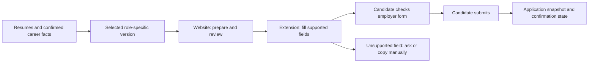

# NaviJob founder playbook

Research snapshot: 26 October 2026. Product stage: discovery and prototype.

This document follows the current candidate-first idea: create a career profile once, preserve several truthful resume versions, reuse information across applications, and optionally connect evidence of projects. It supersedes the earlier suggestion to make agency submission software the primary product. Employer relationships and paid listings are a possible second business, with separate validation requirements.

Evidence labels used here:

- **Observed:** inspected in the local repository or published in the linked source.
- **Company-reported:** a vendor's claim, not independently audited performance.
- **Proposal:** a product or operating decision to test.
- **Unknown:** information we do not have; it must not become a marketing claim.

Public research can establish that a problem and competing products exist. It cannot establish NaviJob's conversion, profitability, retention, or employer trust. No customer interviews, paid-product comparisons, external submissions, or employer outreach were performed for this document.

## 1. The decision in one page

**Build a candidate application workspace that remains useful before a single employer joins NaviJob.**

Initial promise:

> Save your career information once. Choose the right version for each role, reuse your answers on supported application forms, and remember exactly what you submitted.

An initial positioning hypothesis:

> A reusable application workspace for Indian software engineers, with role-specific resumes, project evidence, and accurate autofill across supported hiring systems.

The first target customer is a proposal: Indian software engineers with approximately 1–5 years of experience, applying to backend and full-stack roles through desktop Chrome. Interview users before treating this as the correct segment. Freshers, senior engineers, nontechnical candidates, and mobile-only applicants may have different needs and budgets.

| Founder question | Current answer | Evidence still needed |
| --- | --- | --- |
| What problem are we solving? | Repeated entry of the same career facts, inconsistent resume variants, repeated answers, and uncertainty about what was sent. | Observe real application sessions and measure correction time. |
| Is it a real pain? | Yes, the founder experiences it, established tools address it, and Workday has announced a native response. | How frequent and expensive is it for our chosen segment? |
| Is the idea new? | No. Simplify overlaps with much of this idea already. | Where does our target user still struggle after trying existing tools? |
| Who is the first user? | A candidate actively applying across several employer sites. | A narrow group we can recruit and support personally. |
| Who pays first? | Potentially candidates buying advanced, bounded AI assistance. | Real purchases at a stated price, followed by repeat value. |
| Must employers join first? | No. A candidate can use existing official application pages. | Supported-site permissions, reliability, and useful coverage. |
| Why would employers pay later? | An engaged, eligible, consenting audience that produces qualified applicants. | Actual qualified responses and repeat employer usage. |
| What is our USP today? | A positioning hypothesis; no demonstrated exclusive advantage yet. | A measurable reason users choose NaviJob over Simplify and manual applications. |
| What should we avoid building first? | A general job marketplace, autonomous applications everywhere, a developer scoring system, and enterprise procurement features. | Add scope only when an observed bottleneck justifies it. |

**First milestone:** 20 candidates use it on real applications; at least 10 return for another application and five pay the stated pilot price. These are proposed decision hurdles for a selected cohort, not industry benchmarks or a forecast.

## 2. What exactly hurts, and what counts as solving it?

### 2.1 The candidate's actual job

The candidate wants to submit a suitable, accurate application with little repeated work. A place to store four PDFs is a component, not the full solution.

| Pain | Product response | Evidence that it helped |
| --- | --- | --- |
| Re-entering education, employment, links, and skills | One confirmed profile and supported-site autofill | Lower completion time, including checking and corrections |
| Choosing between backend, full-stack, or other truthful presentations | Named resume versions derived from the same career facts | Correct version selected and no contradictory dates or employers |
| Repeating questions about projects and experience | Reusable answers with facts, context, and an approval step | Less retyping without incorrect company names or stale answers |
| A short resume omits relevant project detail | A structured project library that can supply relevant examples | Useful answers without invented ownership or achievements |
| Forgetting what was submitted | An application record with the resume and answers used | User can recover the exact relevant version later |
| Finding listings that fail basic eligibility | Explicit location, work authorization, role, and other hard filters | Candidate accepts the suggested role as suitable |
| Wanting to demonstrate work | Optional links and clearly scoped evidence signals | A reviewer can inspect the underlying work and its limitations |

Candidate frustration supports investigation. It does not prove willingness to pay. Being eager to apply also does not establish that an applicant is suitable for a particular employer.

### 2.2 Important distinction about Workday

Workday already has employer-specific reuse options. Configurations vary; avoid saying every Workday application always starts from zero.

More importantly, on **13 October 2026**, Workday announced **Workday Candidate Profile**, a reusable candidate-controlled profile, with general availability expected in early 2027. Its employer FAQ identifies the eligible 2027R1 rollout and an employer opt-out. This is announced future availability, not evidence that every employer supports it today. [Workday announcement][workday-announcement], [employer FAQ][workday-employer]

The candidate FAQ describes limits of the planned release: one structured profile, no unified cross-employer application dashboard, no stored employer-specific answers, and no multiple resume personas. Those limits are potential areas to investigate, not proof NaviJob will outperform existing competitors. [Candidate FAQ][workday-candidate]

**Implication:** a business whose entire value is fixing Workday's current repeated-entry experience could lose much of its advantage. Benchmark the native rollout and competing products throughout development. Cross-platform continuity and useful role-specific context are stronger hypotheses, although competitors also offer parts of them.

### 2.3 Scope of the promise

Promise only what the product can demonstrate:

- Reuse supported information accurately.
- Make the selected resume and answers visible before submission.
- Clearly identify unsupported fields and pages.
- Measure saved time against the user's existing process.
- Preserve what the candidate chose to send.

Interview invitations and hiring decisions are downstream outcomes to measure. They are not a service guarantee.

## 3. Who already does this, and what is their scale?

Scale figures below are public company claims as inspected on the research date. Users, indexed profiles, applications, members, active users, hires, revenue run rates, and profit are different metrics. None is a substitute for another.

| Product | Main overlap with NaviJob | Published scale or commercial signal | Interpretation |
| --- | --- | --- | --- |
| [Simplify Copilot][simplify-copilot] and [Simplify+][simplify-plus] | Reusable profile, free core autofill, saved answers, tracking, paid AI tailoring | Reports 2M+ candidates and 200M+ applications through Copilot | Closest direct benchmark. The idea's main features already have a substantial competitor. These are not paid-user counts. |
| [Tsenta][tsenta-yc] | Job matching, resume preparation, application submission, tracking | YC profile reports 90K+ job seekers and approximately $3M annualized revenue | Company-reported run rate, not audited annual profit. [Pricing][tsenta-pricing] advertises $19/month for 600 applications and 25 initial free applications. |
| [Teal][teal] | Career content, multiple resumes, role tailoring, job tracking | Homepage reports 4M+ members and includes unlimited resumes in its free offer | Storing more than four resume versions is a weak standalone paid advantage. Member count does not establish current paying customers. |
| [Huntr][huntr] | Resume tailoring, application autofill, search and application tracking | Reports 500K+ job seekers who have used the product | Evidence of category usage, not an independently verified active subscriber count. |
| [Jobs24x][jobs24x] | Curated discovery and direct career-page links | Retrieved marketing page claims 46K+ professionals; also displays different active-user totals. Advertises ₹599/month access. | Public counters and success claims lack independently verified methodology here. Treat as discovery competition, not proof of revenue or an autofill business. |
| [ClanX][clanx] | Employer relationships, candidate vetting and placement | Reports 150+ roles filled in the preceding 12 months; publishes a success-based employer fee model without upfront fees | A recruiting service model. Placements are not job-posting subscription revenue, and salary secured is not company revenue. |
| [Peerlist][peerlist] | Project-based professional profiles and hiring | Homepage counter shows approximately 268K peers | A public site counter, not a paying-user count. Its [verification documentation][peerlist-verification] describes scoped workplace and education verification. |
| [GitRoll][gitroll] | GitHub-derived developer profiles and skill signals | Homepage claims approximately 5.9M community builders; its [hiring page][gitroll-hiring] refers to 35K+ vetted developers | Different populations and definitions. Neither figure should be presented as active paying users. A related example for the GitHub feature, not a confirmed identification of the user's unnamed site. |
| [Workday Candidate Profile][workday-announcement] | Native reusable career data within eligible Workday application flows | Announced expected early-2027 availability | A direct incumbent response to the pain; no adoption rate assumed. |
| [Naukri / Info Edge][infoedge] | Discovery, employer distribution, paid candidate services and optional auto-apply | June 2026 presentation reports 294K paid Naukri 360/FastForward users and 2.6% paid penetration | India-specific evidence of paid candidate services. These services and denominators differ from NaviJob's proposed subscription. |

We have not verified these vendors' cost per application, customer acquisition costs, churn, India-only paying cohorts, or profit margins. Do not fill those gaps with estimates disguised as research.

### 3.1 What this research supports

- The repeated-entry and resume-management problems are real enough to attract products with substantial usage.
- A freemium candidate tool with paid assistance is an existing model.
- Hiring services and job-listing marketplaces have different economics.
- Existing free alternatives raise the standard for a new product.

It does **not** establish demand for NaviJob specifically or a gap large enough to support it.

### 3.2 First competitor test

Recruit five target candidates. Let them try their current process, Simplify, and a NaviJob prototype using comparable applications. Never submit duplicate applications to an employer for the sake of testing.

Record:

- Setup time, including profile cleanup and extension installation.
- Completion time, including reviewing autofilled fields.
- Corrections, unanswered fields, wrong resume choices, and failures.
- Whether relevant project answers can be reused safely.
- Which tool they choose for their next application without a reminder.
- Which specific feature they will pay for after experiencing the alternatives.

If they prefer Simplify and cannot describe a meaningful unresolved problem, change the offer before expanding the feature list.

## 4. What could our USP be?

### 4.1 Proposed positioning

> One factual career profile, several role-specific presentations, and reusable application context across supported employer sites.

For the initial Indian engineering segment, investigate these details:

- Notice period, current and expected compensation with units and dates, relocation preferences, and earliest availability.
- Backend versus full-stack project emphasis without changing the underlying history.
- Reusable project explanations that preserve personal contribution, team contribution, and project maturity.
- Consistency between the chosen resume and structured application fields.
- An application snapshot showing which version and answers were used.

These are proposed benefits, not claims that competitors lack them. India-specific fields can be copied, and a lower price alone is rarely a lasting advantage.

### 4.2 What would make the positioning credible?

| Claim we might want to make | Evidence required first |
| --- | --- |
| Saves application time | Timed comparisons including corrections and review |
| Handles supported Workday forms well | Documented coverage across multiple employers and form configurations |
| Keeps resumes and answers consistent | Audited examples and a low observed correction rate |
| Helps demonstrate projects | Reviewers find the attached evidence useful and accurately labeled |
| Better for our chosen candidate segment | Users choose it after trying a relevant free alternative |

The first defensible asset would be execution: reliable adapters, a useful correction history, and trusted relationships with a narrow community. Personalization data stays under candidate control; a moat is not an excuse to trap their information.

## 5. What should we build first?

### 5.1 The complete initial loop

1. Upload a resume or enter basic information manually.
2. Review extracted facts and resolve conflicts.
3. Add projects and optional evidence links.
4. Save a small number of named resume versions.
5. Open an actual employer application and select the relevant version.
6. Reuse confirmed information on a supported form.
7. Review, make corrections, and submit through the employer's normal flow.
8. Save the application context and mark the submission state accurately.

**A profile website without steps 5–8 would leave the main repeated-entry pain largely intact.**

### 5.2 A career library, not every possible combination

Do not generate all combinations of projects and bullet points. Keep a confirmed master library and select the relevant facts for a particular role.

| Data | Example information | Rule |
| --- | --- | --- |
| Career facts | Employer, actual role, dates, education, skills | Conflicts need candidate resolution; no AI invention |
| Projects | Goal, stack, personal contribution, team size, maturity, outcomes | Distinguish planned, prototype, tested and production work |
| Evidence | Public PR, repository, deployed product, article, approved case study | Preserve the URL, claim scope and observation date |
| Resume versions | Backend, full-stack, platform engineering | Present the same history differently; do not create contradictory facts |
| Reusable answers | Project challenge, motivation, availability | Preserve context and review changes for each employer |
| Application snapshot | Job URL, selected resume, approved answers, timestamp | Preserve history when the master profile later changes |

Do not ask for every imaginable field during signup. Import once, confirm essentials, and ask for missing information when a real application needs it. Store optional sensitive disclosures separately and never infer them.

### 5.3 Feature order

| Stage | Build | Why |
| --- | --- | --- |
| First usable loop | Confirmed profile, resume versions, project library, export | Establish accurate source information |
| Core pain test | User-invoked autofill on a small declared set of forms, reusable answers, correction reporting | Demonstrate reduced repeated work |
| Paid value test | Bounded AI tailoring, version comparison, relevant project-answer drafts | Test willingness to pay for extra assistance |
| After repeated use | Optional public GitHub connection and evidence cards | Improve context without delaying core utility |
| After an active candidate cohort exists | Verified employer roles and opt-in candidate introductions | Test a separate hiring-side revenue stream |
| After reliability and economics justify it | Approved automation on additional systems | Broaden useful coverage with measured costs |

Initially defer a broad social network, universal ATS coverage, automatic applications everywhere, paid skill badges, raw commit-count rankings, and employer subscriptions sold solely on registration counts.

## 6. How would it work technically?

### 6.1 A website alone has an important limitation

The NaviJob website can manage profiles, resumes, drafts and jobs. It cannot ordinarily manipulate an unrelated employer page already open in the candidate's browser. For that workflow, a user-installed extension is the practical first route. Official integrations require the appropriate access; remote browser agents are another route with greater operational complexity.

Proposal: **website for the career workspace; a small Chrome extension for user-invoked autofill.** Make the installation requirement clear before promising external-site autofill. Candidates who only use the website should still receive useful exports and copyable answers.

Chrome's `activeTab` mechanism provides temporary access after a user gesture. Start with the least permissions required; explicitly assess embedded frames and navigation rather than assuming one permission handles every application. [Chrome documentation][chrome-active-tab]



### 6.2 Engineering approach

- Parse once; validate and cache confirmed information rather than repeatedly asking a model to rediscover it.
- Use explicit mappings for predictable fields. Use AI for drafting and ambiguous interpretation where it adds value.
- Never silently change the candidate's chosen resume version.
- Separate extraction confidence from candidate confirmation.
- Treat job pages, uploaded files and repository text as untrusted input. Their contents must not change agent permissions or authorize actions.
- Put the review screen before the final submission. Credentials, passwords, verification codes and unfamiliar sensitive questions remain user-controlled in the initial version.
- Validate file types, sizes and parser behavior; do not execute uploaded documents or connected repositories.
- Keep failure states visible. A partial form fill is not a completed application.

An official API is not universal submission permission. For example, Greenhouse's public job-board reads are unauthenticated, while its submission endpoint requires an API key. Public discovery and authenticated submission are different capabilities. [Greenhouse documentation][greenhouse-api]

Do not depend on automating LinkedIn: its published policy prohibits third-party software that automates activity on its site. Review each integration's actual access and policy requirements rather than assuming candidate consent alone settles them. [LinkedIn policy][linkedin-automation]

### 6.3 Coverage and reliability

First observe approximately 20 application flows: for example, ten Workday configurations and five each on Greenhouse and Ashby. This is a proposed discovery sample, not a claim of current support.

Choose the first two supported systems from observed demand and implementation difficulty. If Workday remains the strongest observed pain, test it early while accounting for its announced native profile. Publish the tested scope and fallback behavior.

Use states such as:

`draft -> prepared -> filled -> candidate_reviewed -> submitted_unconfirmed -> confirmed`

Include `unsupported`, `failed` and `uncertain` where needed. A candidate manually marking an application as sent remains a self-report. Only a real confirmation should be presented as observed confirmation. Avoid duplicate retries after an uncertain submission.

Store a snapshot of the selected file and approved answers. Editing NaviJob later must not imply that the employer's stored application changed. Deleting NaviJob data also cannot automatically delete copies already sent to an employer.

### 6.4 What exists in this repository?

Static inspection on the research date found:

| Existing item | What it provides | What it does not establish |
| --- | --- | --- |
| [README](README.md) and [setup guide](SETUP.md) | Next.js, Django and Supabase/Postgres direction | A production candidate workflow |
| [ApplicantProfile](backend/apps/accounts/models.py) | Candidate fields and profile relationships | Cross-site autofill or confirmed career-fact history |
| [Resume model](backend/apps/resumes/models.py) | JSON content, PDF attachment and template fields | Resume parsing, version lineage or validated AI scoring |
| [Job API](backend/apps/jobs/views.py) | Internal listings and authenticated internal applications | Successful submission to an external employer ATS |
| [Demo authentication](frontend/src/lib/demoAuth.ts) and preview routes | Local demonstration flow | Production identity, secure access to real profiles, or real marketplace activity |
| Payment and subscription models | Initial storage structures | Working billing, entitlements or profitable pricing |

The internal job API marks a NaviJob application submitted. That event must remain distinct from an external ATS submission in future reporting.

Keep the existing Next.js/Django foundation unless implementation evidence requires a change. The logical additions are confirmed career facts, project evidence, resume versions, answer templates, application snapshots, integration state and AI usage accounting. These do not each require a separate service or a database table immediately.

The existing `ats_score` field is not evidence of a validated employer score. Any later checks should describe what was actually tested, such as formatting or keyword coverage, without predicting hiring decisions.

This document changes strategy documentation only. Runtime behavior and production integrations were not validated as part of this task.

## 7. Should we connect GitHub and call candidates verified?

**Connect GitHub optionally; describe exactly what was established.**

| Signal | Accurate label | What it does not prove |
| --- | --- | --- |
| Candidate authorizes their GitHub account | GitHub account connected | Legal identity, employment or engineering skill |
| Public repository or PR was inspected | Public project/contribution evidence linked | Sole authorship, commercial impact or production quality |
| Candidate supplies a work email and verifies access | Work email confirmed at a stated date | Exact title, employment dates or all resume claims |
| A reviewer examines specified evidence | Specified evidence reviewed | A universal guarantee of candidate quality |

An OAuth sign-in establishes control of an account at that time. It is not general professional verification. GitHub contribution displays also depend on attribution and visibility rules, so a green contribution graph is an incomplete signal. [GitHub contribution documentation][github-contributions]

Proposal for a first GitHub feature:

1. Optional connection, with clear consent and minimum permissions.
2. Candidate selects public projects or PRs they want to showcase.
3. Show source links, contribution context and last checked dates.
4. Let the candidate explain their role and correct summaries.
5. Make employer sharing opt-in and revocable for future access.

GitHub supports public-data access and fine-grained app permissions. Broad repository scopes are unnecessary for a public evidence feature and can grant much more access than intended. Check exact endpoint permissions during implementation. [GitHub scopes][github-scopes], [GitHub App permissions][github-permissions]

Avoid asking for private employer source code. Engineers whose work is private, proprietary, on another code host, or outside GitHub need alternative evidence paths. Forks, generated commits, stars and activity volume should not become an opaque employability score.

[Peerlist's verification][peerlist-verification] and [GitRoll's developer profiles][gitroll] are examples to study. The exact GitHub-based website mentioned in the conversation remains unidentified.

## 8. How do we get candidates before we have employers?

### 8.1 Start with independent candidate utility

Candidates can bring a real job URL they already found. They do not need to wait for employers to post on NaviJob to use a profile, prepare an application, or autofill a supported page.

This removes the initial need to solve both sides of a marketplace at once. It does not remove technical integration work or the need to acquire users.

First distribution experiments:

- Recruit ten candidates personally from a narrowly relevant community.
- Demonstrate a real application with synthetic personal data before asking users to upload their own information.
- Publish short, honest walkthroughs of supported forms and their limitations.
- Invite users to share useful project profiles or templates, with sharing optional.
- Work with a small coding community, career coach or placement group whose members fit the target segment.
- Ask returning users for introductions after they experience value.

Community posts need to follow community rules. Growth assumptions should include the founder's time; unpaid outreach is not economically free.

Track each acquisition source separately. A broad waitlist, a giveaway signup, a profile creation and a candidate who repeatedly applies are different levels of intent.

### 8.2 Where do initial jobs come from?

Use user-provided job URLs and permitted official career-page data first. Add employer-submitted roles when there is an actual relationship.

For every displayed role, record source URL, employer, requisition identifier where available, first seen, last checked, application destination and closure state. Never present first-seen time as the employer's original posting time.

Label these cases separately:

- **External role:** found on an official or permitted source; no partnership implied.
- **Employer-submitted role:** a checked representative supplied it.
- **Partner role:** a real commercial or operational relationship exists.
- **Sponsored role:** paid promotion, clearly labeled.

A copied public listing does not establish that the company trusts, endorses or pays NaviJob. Avoid using employer logos as implied customer endorsements.

## 9. How do we find employers or agencies willing to pay?

### 9.1 Understand what they would actually buy

Employers buy access to suitable, interested candidates or an improvement to hiring work. A job-posting form by itself offers little reason to pay a new platform.

An agency may source candidates for a client, advertise a role, or seek new client mandates. These are different needs. Do not assume an agency asking for leads wants to buy a job slot.

| Potential buyer | Reason they might pay | What NaviJob must demonstrate |
| --- | --- | --- |
| Startup founder or engineering lead | Access to a relevant engineering cohort | Eligible, interested candidates and useful conversations |
| Small in-house recruiter | Another productive source for a difficult role | Qualified responses at acceptable cost and effort |
| Specialist recruitment agency | Candidates fitting a current authorized client mandate | Candidate availability, relevant experience and clear submission ownership |
| Large employer | Reliable additional sourcing or workflow value | A repeatable pilot, responsible data handling and compatibility with its process |

Startups are a practical initial relationship hypothesis because an individual decision maker may be easier to reach. That is not evidence that startups automatically trust new platforms or have budget.

### 9.2 Build a focused prospect list

Create a list of 30 organizations with a current, publicly advertised role matching the active candidate segment. Use official career pages, public hiring announcements, founder communities, permitted directories and warm introductions.

For each prospect, record:

- Role and official source; last confirmed open date.
- Person responsible for hiring and a public business contact route.
- Whether it is a direct employer or an agency mandate.
- Required skills, location, seniority and any explicitly published constraints.
- Number of currently interested NaviJob candidates who actually meet those requirements.
- Last conversation, permission to share information, next action and eventual result.

Never make up a candidate count to strengthen the pitch. Before sharing a profile, obtain the candidate's permission for that opportunity and identify the actual receiving party.

### 9.3 A credible first outreach message

Use only after the bracketed facts are true. This is a draft, not authorization to send outreach.

> Hi [name], I saw your [role] opening on [official source]. We are testing NaviJob with [actual number] engineers in [specific segment]. [Actual number] meet the published requirements and have agreed to an introduction. Could we run one small pilot using your existing hiring process? I can share a redacted sample profile first and report what happened, with candidate permission throughout.

If there are no suitable candidates yet, ask for a discovery conversation about that role. Do not pretend to offer a ready shortlist.

### 9.4 The first employer pilot

- One checked role and one named hiring contact.
- Explicit requirements and a definition of a qualified applicant.
- A small set of candidates who have opted in and confirmed interest.
- Applications delivered into the employer's existing process.
- Review date, closure handling and feedback expectations agreed beforehand.
- A report of introductions, qualified responses and interviews, with known limits.

Success is an employer returning with another role or agreeing to pay for continuing value. A logo on a landing page or a polite introductory call is not equivalent evidence.

### 9.5 MNCs come after proof

The candidate tool can assist an applicant using an MNC's official process without selling a new recruiting system to that company. A paid enterprise relationship is a separate effort.

For that effort, earn a small pilot with one team, retain the employer's ATS, provide clear data handling and deletion practices, and supply references from real earlier customers. Address actual procurement requirements when they arise. Do not claim certifications, official integrations or enterprise readiness that have not been established.

## 10. Why would anyone trust a new founder?

Trust is built through a small, inspectable promise delivered consistently.

| Audience | First trust question | Product or operating response |
| --- | --- | --- |
| Candidate | Will my resume or identity be exposed? | Private by default; explicit sharing; clear export and deletion controls |
| Candidate | Will AI lie about me? | Source-linked facts, visible edits, confirmation and correction |
| Candidate | What can this extension access? | Minimal permissions and an understandable explanation of when it runs |
| Candidate | What am I paying for? | Clear limits, usage record, cancellation and handling of failed paid actions |
| Recruiter | Are these applicants real and interested? | Scoped identity/account signals, recent candidate confirmation, opt-in introductions |
| Employer | Does verification mean the same thing for everyone? | Separate evidence labels, dates, methods and limitations |
| Employer | Will this disrupt my existing process? | Existing ATS and normal application flow remain usable |

Practical early trust work:

- Show who operates NaviJob and provide a working support channel.
- Demonstrate the product using synthetic or explicitly authorized data.
- Publish coverage and known limitations instead of universal claims.
- Obtain permission before publishing testimonials or employer relationships.
- Clearly mark demo companies, applicants, listings and metrics.
- Keep public profiles optional; do not expose compensation preferences or private answers by default.
- Use access-controlled file storage, server-side authorization, expiring access links where appropriate and protected integration tokens.
- Explain which data is sent to model providers; choose actual provider settings and retention terms before promising a policy.
- Publish a realistic deletion process, including backups and limits on data already delivered to employers.
- Obtain appropriate professional review for jurisdiction-specific privacy and commercial terms before a public launch. This document is not a compliance assessment.

The first trust milestone is a candidate safely completing a second real application. Employer trust comes from accurate, consented interactions and useful results over time.

## 11. What should we charge?

### 11.1 Start with a simple candidate offer

These are price hypotheses, not established willingness to pay. Start with one paid plan and measure it.

| Plan | Proposed price | Proposed initial scope |
| --- | --- | --- |
| Free | ₹0 | One career library, up to four uploaded resumes and four saved role versions, manual editing/export, basic supported autofill, application history and a small one-time AI trial |
| Pro | Test ₹299 for 30 days | Up to 20 uploaded resumes, 20 saved role versions and 20 completed AI tailoring actions during the period, version comparison and project-answer drafting |

Define a paid AI action clearly: for example, one bounded, completed tailoring workflow returning an editable draft and answer set for candidate review. Publish document/input limits, refund usage for failed paid actions, and measure cost at both average and heavy usage. Paid limits should not block access to a user's existing data or exports after expiry.

Basic autofill is already free in a major competitor, and Teal's free offer includes unlimited resumes. A fifth uploaded PDF is unlikely to be a strong paid proposition by itself. Sell useful assistance and better workflow outcomes. [Simplify][simplify-plus], [Teal][teal]

Offer a clearly described 30-day pilot before assuming automatic renewal. Test ₹299 and a later ₹499 offer with comparable cohorts and honest terms; do not infer a winning price from a few friends accepting a discount.

### 11.2 What does priority mean?

Possible premium services include faster NaviJob support or a specifically defined human review turnaround, if operationally feasible.

Do not sell an employer ranking advantage that NaviJob cannot provide. A paid profile is not a verified skill credential. Any future sponsored visibility must be labeled, and any employer response commitment requires an actual agreement. Keep job relevance independent of candidate spending.

### 11.3 Employer pricing is a later experiment

For the first three checked employer pilots, propose one free role for 30 days with a defined feedback process. This is a limited learning offer, not a promise of a permanent free hiring service.

After demonstrated qualified responses and repeat demand, test **₹1,499 per role for 30 days** for distribution to the relevant opt-in audience and response reporting. Agencies can buy the same offer for authorized mandates initially; do not launch another complicated plan grid.

If buyers want screening or placement services, scope and price that separately. Do not treat a human recruiting service's revenue as software margin. ClanX's published success-based model illustrates why listing fees and placement services must be analyzed separately. [ClanX][clanx]

### 11.4 A unit-economics worksheet that includes free users

Hypothetical assumptions:

- Monthly Pro revenue per paying user, excluding any tax collected: **₹299**.
- Variable monthly cost per paying user: **₹60**, including AI, processing, payments, support and refund allowance.
- Variable monthly cost per free active user: **₹2**; this is an aggressive assumption to benchmark, not a vendor quote.
- Average paid lifetime: **three months**.
- Acquisition cost per new paying customer: **₹150**; do not assume founder sales time is free when evaluating this.
- Fixed monthly cash cost: **₹3,000**.
- Steady state; spending to replace departing customers is included. Initial development, growth investment, founder salary and taxes are excluded.

Per paid customer: ₹299 − ₹60 = **₹239 contribution/month** before acquisition and fixed costs. Three paid months produce ₹717 contribution; subtracting ₹150 acquisition leaves ₹567 before free-user and fixed costs. The paid contribution-to-acquisition ratio is 4.78× under these assumptions only.

For **10,000 monthly active users**:

| Paying share of active users | Paying users | Monthly revenue | Surplus after variable costs, replacement acquisition and fixed cost |
| --- | ---: | ---: | ---: |
| 1% | 100 | ₹29,900 | **−₹3,900** |
| 3% | 300 | ₹89,700 | **₹34,300** |
| 5% | 500 | ₹149,500 | **₹72,500** |

Formula:

```text
monthly_surplus =
  paid_users * (299 - 60)
  - free_active_users * 2
  - (paid_users / 3) * 150
  - 3000
```

Paying share of active users is not visitor-to-paid conversion. These values are scenarios, not market estimates. Naukri's published penetration cannot be transplanted into this model.

The ₹5,000/day aspiration corresponds to roughly ₹150,000/month averaged over 30 days. Under the 5% scenario and the same fixed-cost assumption, it would require approximately 20,265 monthly active users. Costs and staffing may grow before that scale; this is sensitivity analysis, not an income promise.

Track acquisition cash spend and founder acquisition hours separately; calculate a version including the value of those hours. Monitor variable cost at the 90th percentile of usage. Global AI spending caps and per-user quotas should prevent a free feature from creating an uncontrolled bill.

## 12. What should we measure?

All thresholds below are proposed pilot hurdles. They are not universal YC rules, statistically established benchmarks, or probabilities of success.

| Metric | Definition | Initial decision hurdle |
| --- | --- | --- |
| Activation | Confirm profile, choose a version, and use it on one real supported application | At least 15 of 20 selected pilot users complete the loop |
| Repeated utility | Use the product on another application within 14 days | At least 10 of the 20 return without repeated founder prompting |
| Time saved | Comparable baseline versus NaviJob, including review and corrections | At least 50% lower median user time in the observed flows |
| Field accuracy | Correct populated fields / audited populated fields | At least 98% on the declared supported scope, with counts reported |
| Critical factual errors | Wrong qualifications, dates, identity or eligibility introduced by the product | Zero observed; pause the affected path when detected |
| Supported-flow completion | Supported attempts reaching a usable reviewed form / all supported attempts | At least 95%; publish failures and handoffs separately |
| Paid demand | Selected pilot users paying the stated 30-day price | Five paying users; identify friends, discounts and founder assistance separately |
| Serving cost | Total measured cost per active free user and paid user | Positive contribution at actual use, including failures and support |
| Employer utility | Review, qualified response and repeated role request | Three small pilots; seek repeat use and then one full-price purchase |
| Interview response | Interviews attributable to a defined application cohort and observation period | Observe for 30–45 days; no guaranteed uplift claim from a tiny sample |

Also record browser, ATS, employer configuration, input version and adapter version for failures. An adapter succeeding on one employer is not evidence of coverage across every employer on that ATS.

For retention, report both the whole cohort and candidates still actively searching. Record departures after a job offer separately from departures caused by poor value. Do not silently remove unsuccessful users from the denominator.

An application completed faster can be valuable even without a measured interview uplift. Conversely, more application events alone do not establish customer success.

## 13. A practical first 30 days

### Days 1–7: watch the work and benchmark alternatives

- Interview 15–20 target candidates; observe at least five application sessions with permission.
- Ask about their last application, actual time, corrections, tools tried and money spent.
- Benchmark existing free tools before writing broad automation.
- Record which fields and questions repeat, and what users still cannot reuse.
- Interview five hiring-side contacts to understand qualified candidate requirements, without promising a candidate pool.

Deliverable: a narrow problem statement, a list of unresolved tasks and an explicit reason to try NaviJob.

### Days 8–14: complete one useful loop

- Use the existing stack for a private candidate workspace.
- Implement confirmed information and role-version selection.
- Support a narrow form scope with a copy/manual fallback.
- Add visible review, corrections and an application snapshot.
- Onboard the first ten candidates personally.

Deliverable: candidates can complete a real task with measured assistance. No claim of universal coverage.

### Days 15–21: test repeat use and payment

- Expand to 20 selected candidates.
- Offer the clearly described ₹299 pilot.
- Measure returns, support time, paid-action cost and coverage failures.
- Ask what users chose for their next application and why.
- Keep an explicit list of requests that are deferred.

Deliverable: evidence of repeat behavior and initial purchases, including negative results.

### Days 22–30: repair the largest bottleneck

- Fix the most frequent failure before adding another broad feature.
- Add optional project/GitHub evidence only if users need it in their existing application workflow.
- Count genuinely active, interested candidates in the target role segment.
- If that cohort can help a real open role, propose one small employer pilot.
- Review economics, competitor changes and the next investment decision.

Deliverable: continue, narrow the offer, change pricing, or stop this direction based on recorded evidence.

These are a learning sequence, not a guaranteed four-week engineering schedule. Public extension distribution and production hardening can take additional work. Keep each promised capability aligned with the actual available build.

## 14. Questions to ask instead of asking whether people like the idea

### Candidate interview

1. Walk me through the last job you applied for. Where did you spend time?
2. Which information did you type again, and which autofilled incorrectly?
3. Show me how you choose or edit a resume for a role.
4. Which questions require examples that are missing from your resume?
5. Which tools have you tried, including free ones? Why did you keep or stop using them?
6. Have you paid for help? What did you buy and what happened?
7. What information would you refuse to upload or connect?
8. After using this prototype, which tool would you use tomorrow?
9. Will you buy the stated pilot now for the task you just experienced?

### Recruiter or employer interview

1. Show me the last difficult role and the actual hiring workflow.
2. Which sources produced interview-worthy candidates?
3. What makes an application unqualified for this role?
4. What information is missing from most candidate submissions?
5. What evidence would you inspect: resume, project, GitHub contribution, live demo, reference or assessment?
6. Who owns the budget, and what did you last pay for sourcing?
7. What would make a new source worth trying for one role?
8. What would have to happen for you to use it again and pay?

Observe past behavior and ask for concrete commitments. Compliments, survey enthusiasm and a large waitlist are weaker evidence than repeated use and payment. Early manual recruitment and delivery are consistent with the approach described in [Paul Graham's essay][paul-graham].

## 15. Founder checklist and decision gates

### Before expanding the MVP

- [ ] We can name the initial candidate segment and reach at least 20 of them.
- [ ] We have observed real applications rather than relying only on our own frustration.
- [ ] We have compared the workflow with Simplify and the user's current approach.
- [ ] Users can explain a meaningful advantage after trying both.
- [ ] The product reduces repeated work outside NaviJob, on the declared supported scope.
- [ ] Candidate facts remain consistent across resumes and form answers.
- [ ] We distinguish page fill, self-reported submission and observed confirmation.
- [ ] At least ten pilot candidates return and five buy the stated offer, or we have documented why the offer needs revision.
- [ ] We know free-user cost, paid-user cost and support effort.
- [ ] Demo activity is visibly separate from real activity.

### Before charging employers

- [ ] The relevant candidate cohort is active, eligible and opted in.
- [ ] We can demonstrate cohort quality without exposing private profiles prematurely.
- [ ] A real hiring contact confirms the role and review process.
- [ ] Agency mandates and direct-employer roles are clearly distinguished.
- [ ] We have permission for introductions and do not imply partnerships from public listings.
- [ ] Earlier employers return or provide specific evidence of value.
- [ ] The buyer understands exactly what the listing or service fee purchases.

### Before using verification or priority claims

- [ ] Every badge states the specific check, method and date.
- [ ] GitHub account control is not described as verified professional ability.
- [ ] Candidates with private or non-GitHub work have a fair alternative.
- [ ] Paid access does not manufacture a verification credential.
- [ ] Any promised employer priority is backed by a real, disclosed arrangement.

### Before investing another month

- [ ] Review actual user returns, purchases, costs and failures weekly.
- [ ] Recheck Workday's planned release and competing free functionality.
- [ ] Compare the return from repairing the main pain with adding a requested feature.
- [ ] Give greater weight to independent customers than friends or founder-assisted demos.
- [ ] Set the next concrete evidence milestone and spending limit.

Continue when users repeatedly choose the product and its economics can work. Narrow or change direction when setup friction, weak paid value, unsupported forms or a superior free alternative prevent that behavior. Do not let the purchased domain or existing marketplace code determine the business.

## 16. Confirmed direction, proposals and open questions

**Confirmed by the current request:** candidate-first utility; reusable career information and projects; approximately three to four free resume uploads; paid customization/AI under consideration; interest in optional work evidence; later employer relationships; low initial spending.

**Proposed here:** four free uploaded resumes; a website plus a user-invoked extension; Indian engineering applicants as the first segment; a ₹299/30-day Pro test; employer distribution after a useful candidate cohort; limited supported forms; no autonomous submission in the first version.

**Still unknown:** which candidate segment prefers this to existing tools; whether an extension is acceptable to those users; the exact unnamed GitHub platform; acquisition costs; real serving costs; paid lifetime; which employers would buy; actual supported-site coverage; public-launch policies and operational capacity.

This is a product direction and validation document. It is not a record of shipped candidate automation, confirmed employer partnerships, independently audited competitor results, or validated profitability.

## Research sources

All links were consulted in this conversation; the working research snapshot for this document is 26 October 2026. Recheck pricing, counters, feature limits and release plans before relying on them commercially. Prefer the specific product documentation over broad marketing headlines when they differ.

- [Workday announcement, 13 October 2026][workday-announcement] — native reusable-profile announcement and expected availability.
- [Workday candidate FAQ][workday-candidate] — planned profile scope and release limitations.
- [Workday employer FAQ][workday-employer] — eligible rollout and employer configuration.
- [Simplify Copilot][simplify-copilot] — autofill, tracking and company-reported usage scale.
- [Simplify+ documentation][simplify-plus] — distinction between free autofill and paid AI assistance.
- [Tsenta YC profile][tsenta-yc] — company-reported user scale and annualized revenue claim.
- [Tsenta pricing][tsenta-pricing] — published application allowances and prices.
- [Teal][teal] — member claim and free resume offer.
- [Huntr][huntr] — product coverage and historical user claim.
- [Jobs24x][jobs24x] — discovery offer and indexed marketing claims; no independent verification of counters.
- [ClanX][clanx] — employer recruiting service, placement claims and success-fee positioning.
- [Peerlist][peerlist] and [verification help][peerlist-verification] — professional profiles and scoped verification methods.
- [GitRoll][gitroll] and [hiring page][gitroll-hiring] — GitHub-based profiles and differently defined scale claims.
- [Info Edge investor presentation, August 2026][infoedge] — June 2026 candidate-services metrics, particularly slides 10 and 15.
- [Chrome activeTab documentation][chrome-active-tab] — temporary, user-invoked extension access.
- [GitHub OAuth scopes][github-scopes], [app permissions][github-permissions] and [contribution display][github-contributions] — permissions and evidence limitations.
- [Greenhouse Job Board API][greenhouse-api] — public reads versus authenticated submissions.
- [LinkedIn automation policy][linkedin-automation] — platform dependency constraints.
- [Do Things That Don't Scale][paul-graham] — founder-led recruitment and early manual delivery.

[workday-announcement]: https://investor.workday.com/news-and-events/press-releases/news-details/2026/New-Workday-Candidate-Profile-Lets-Job-Seekers-Save-Their-Information-Once-and-Use-It-Every-Time-They-Apply-Through-Workday/default.aspx
[workday-candidate]: https://community-content.workday.com/en-us/public/products/talent-management/talent-acquisition/workday-candidate-profile.html
[workday-employer]: https://community-content.workday.com/content/workday-community/en-us/public/products/talent-management/talent-acquisition/workday-candidate-profile-employer-faq.html?lang=en-us
[simplify-copilot]: https://simplify.jobs/copilot
[simplify-plus]: https://help.simplify.jobs/en/help/articles/9660493-use-copilot-with-simplify
[tsenta-yc]: https://www.ycombinator.com/companies/tsenta
[tsenta-pricing]: https://tsenta.com/pricing
[teal]: https://www.tealhq.com/
[huntr]: https://huntr.co/
[jobs24x]: https://jobs24x.com/
[clanx]: https://www.clanx.ai/
[peerlist]: https://peerlist.io/
[peerlist-verification]: https://peerlist.neetokb.com/articles/what-is-peerlist-verification-and-how-to-get-verified
[gitroll]: https://gitroll.io/
[gitroll-hiring]: https://gitroll.io/find-devs
[infoedge]: https://www.infoedge.in/pdfs/corporatePresentations_pdfs/Info-Edge-Aug26-Presentation.pdf
[chrome-active-tab]: https://developer.chrome.com/docs/extensions/develop/concepts/activeTab
[github-scopes]: https://docs.github.com/en/apps/oauth-apps/building-oauth-apps/scopes-for-oauth-apps
[github-permissions]: https://docs.github.com/en/apps/creating-github-apps/registering-a-github-app/choosing-permissions-for-a-github-app
[github-contributions]: https://docs.github.com/en/account-and-profile/how-tos/contribution-settings/viewing-contributions-on-your-profile
[greenhouse-api]: https://docs.greenhouse.io/job-board.html
[linkedin-automation]: https://www.linkedin.com/help/linkedin/answer/a1340567/prohibited-software-and-extensions
[paul-graham]: https://paulgraham.com/ds.html
